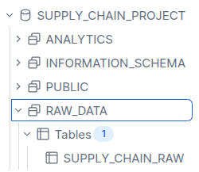
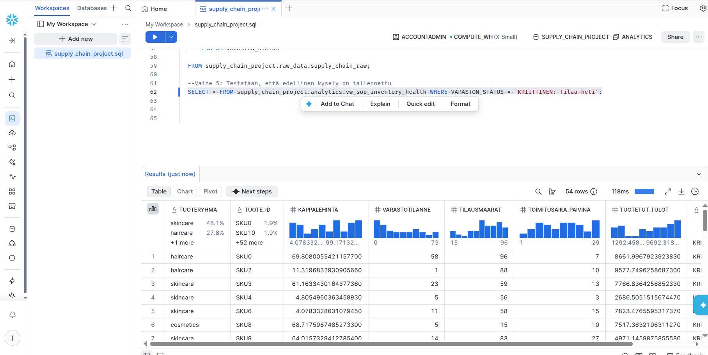

# Snowflake Supply Chain & S&OP Analytics Project

Tämä projekti on luotu osaksi hakuprosessia Data Analyst (Part-time) -tehtävään. Projektissa rakennetaan moderni ELT-dataputki (Extract, Load, Transform) Snowflake-ympäristöön hyödyntäen Kagglen toimitusketjudataa.

## Projektin tavoite
Projektin tavoitteena on harmonisoida raakadataa ja luoda liiketoimintalogiikkaa myynnin ja toiminnan suunnittelun (S&OP) tueksi. Erityisenä painopisteenä on varastotilanteen kriittisyyden ja logistiikan seuranta.

## Teknologiat
- **Data-alusta:** Snowflake (Enterprise Edition pilvessä)
- **Kieli:** SQL
- **Tietolähde:** Kaggle Supply Chain Sales Analytics Dataset

## Arkkitehtuuri ja tietokannan rakenne (ELT)
Projektissa sovelletaan modernia ELT-arkkitehtuuria, jossa data erotetaan raakadataksi (Raw/Staging) ja jalostetuksi analytiikkakerrokseksi:

1. **Extract / Load:** Raakadata ladattiin CSV-muodossa sisään Snowflakeen `SUPPLY_CHAIN_PROJECT.RAW_DATA`-skeemaan taulukoksi `SUPPLY_CHAIN_RAW`.
2. **Transform (Liiketoimintalogiikka):** Datan päälle rakennettiin analytiikkakerros (`ANALYTICS`-skeema). SQL-logiikalla luotiin uudelleenkäytettävä näkymä (View) varastosaldojen kriittisyyden seurantaan.

- **`SUPPLY_CHAIN_PROJECT.RAW_DATA.SUPPLY_CHAIN_RAW`**: Alkuperäinen raakadata.
- **`SUPPLY_CHAIN_PROJECT.ANALYTICS.vw_sop_inventory_health`**: SQL-logiikalla luotu analytiikkanäkymä.

*(Lisää tähän väliin halutessasi kuvakaappaus Snowflaken vasemmasta sivupalkista, jossa näkyy tietokantapuu)*  

## S&OP Liiketoimintalogiikka (SQL Transformation)
Käytin SQL:n `CASE WHEN` -logiikkaa luokittelemaan tuotteet automaattisesti kolmeen eri kategoriaan varastotilanteen ja tilausmäärien suhteen:
1. **KRIITTINEN: Tilaa heti** (Varastotilanne on pienempi kuin tilausmäärä)
2. **HUOMIO: Seuraa tilannetta** (Varasto on vähissä, mutta kattaa juuri senhetkisen tilauksen)
3. **OK: Varasto riittävä** (Varastosaldo on turvallisella tasolla)

## Tulokset ja esikatselu
Tältä valmis jalostettu data näyttää Snowflake-ympäristössä suoritetun ad-hoc-haun jälkeen. Kysely palauttaa suoraan vain ne tuotteet, joiden kohdalla varastosaldo on hälyttävän matala:

*(Lisää tähän väliin ottamasi kuvakaappaus Snowflaken kyselytuloksista)*  

## SQL-skriptit
Projektissa käytetty täydellinen SQL-koodi tietokantojen, skeemojen, sääntöjen ja näkymien luomiseen löytyy tiedostosta: `01_raw_to_analytics_pipeline.sql`.
